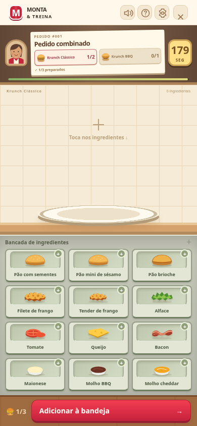
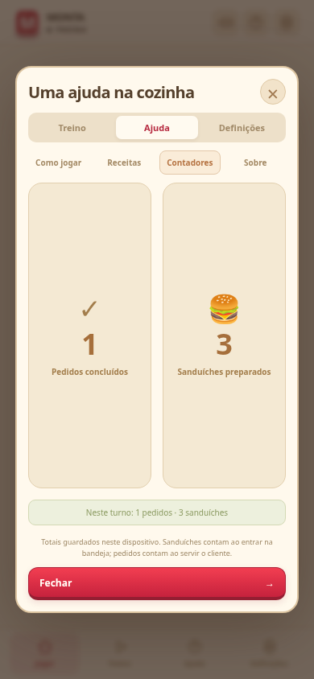
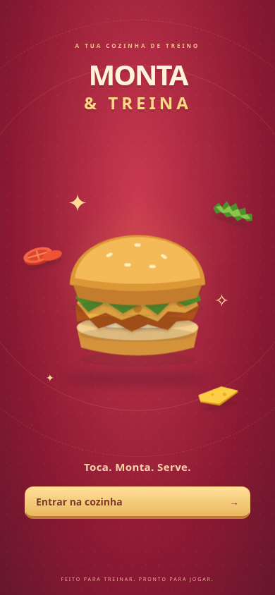
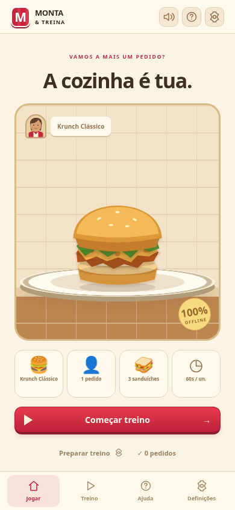
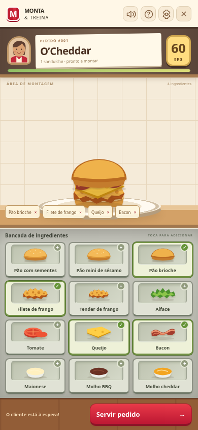
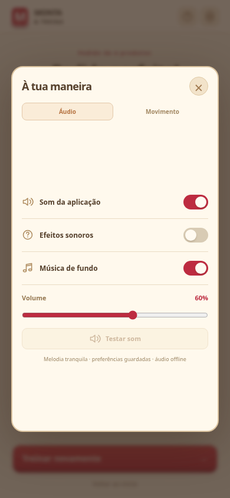

# Monta & Treina

Simulador de treino para Android, em português de Portugal. Cozinha visual com cliente, talão de pedido, ingredientes na bancada e um sanduíche que ganha camadas a cada toque. Quatro receitas, rondas de 30/60/90 segundos, revisão de erros e recordes por produto e duração guardados no dispositivo. Funciona offline no APK; não usa conta, servidor, análise de utilização ou serviços externos.

## Como jogar

1. No início, abre **Treino** ou toca nos cartões ilustrados. Escolhe a receita, o modo, o tamanho do **Pedido** e o tempo nas respetivas abas. Guarda e toca em **Começar treino**.
2. O pedido aparece no talão, junto ao cliente e à barra de tempo.
3. Toca nos ingredientes da bancada para os adicionar. O sanduíche ganha camadas ilustrativas. Toca novamente no recipiente para o retirar.
4. Nos pedidos combinados, toca em **Adicionar à bandeja** depois de montar cada sanduíche. Só montagens corretas são contabilizadas. Quando a bandeja estiver completa, toca em **Servir pedido** antes de acabar o tempo. Nos resultados, alterna entre **Resumo** e **Revisão**. Os grupos Corretos, Faltaram e A mais mostram os ingredientes com ilustrações e páginas quando necessário.
5. No modo turno, avança para o próximo cliente. No fim vês quantos dos cinco pedidos ficaram perfeitos.

A interface usa a altura do ecrã e não exige deslocação vertical: início, preparação, ajuda, definições, cozinha e resultados. Os conteúdos mais longos estão divididos em abas e páginas; os testes verificam também se os controlos continuam visíveis e clicáveis, em vez de apenas ocultar o scroll. São verificados ecrãs de 320 × 568, 390 × 844, 740 × 360 e 1024 × 768.

## Pedidos combinados e contadores

Em **Treino → Pedido**, escolhe de 1 a 4 sanduíches por cliente e a composição:

- **Iguais:** repete a receita escolhida; com receita aleatória, o tipo é sorteado e repetido.
- **Variados:** inclui pelo menos dois tipos. A receita escolhida participa no pedido e os restantes produtos são sorteados. Pode haver tipos repetidos e diferentes no mesmo talão.

O talão apresenta **preparados/quantidade pedida** por produto e o total do pedido. Podes tocar num produto ainda em falta para o preparar; ao mudar, a montagem atual é limpa. Depois de cada unidade válida, a bancada fica pronta para o próximo sanduíche em falta. As quotas impedem acrescentar produtos a mais. Um pedido de três sanduíches só fica concluído quando os três estiverem na bandeja e o cliente for servido.

O tempo escolhido é **por sanduíche**: 3 × 60 segundos dá 180 segundos para o cliente inteiro. O relógio continua entre montagens. A ajuda pausa o tempo como antes. Se o prazo terminar, a revisão mantém a contagem parcial de cada produto.

Em **Contadores**, no início ou na ajuda, podes consultar os totais guardados no dispositivo. **Sanduíches preparados** conta montagens validadas; **Pedidos concluídos** conta clientes servidos corretamente dentro do prazo. Sanduíches de pedidos que ficaram incompletos continuam no contador de produção. O resumo do turno distingue pedidos e sanduíches. Um novo turno reinicia apenas os valores do turno. Os recordes de combos usam chaves separadas das receitas individuais.





## Abertura e carregamento

A abertura mostra o sanduíche a montar-se, ingredientes flutuantes e a identidade visual do jogo. Avança automaticamente ou através de **Entrar na cozinha**. O arranque nativo Android e o primeiro conteúdo HTML usam a mesma paleta.

Antes de cada pedido, uma transição animada prepara a bancada e aguarda a preparação das fontes locais. O cronómetro só começa quando a cozinha está disponível. A animação pode ser cancelada e respeita as definições de movimento reduzido. Não simula percentagens de downloads.







## Ajuda, áudio e animações

- **Ajuda:** disponível no menu e no botão de interrogação durante o treino. Tem abas **Como jogar**, **Receitas**, **Contadores** e **Sobre**. O guia avança passo a passo e as receitas usam ingredientes ilustrados. O relógio fica em pausa enquanto o painel está aberto e retoma ao fechá-lo.
- **Definições:** abas **Áudio** e **Movimento**, com som geral, efeitos, música de fundo, volume e animações guardados no dispositivo. Também existe um botão rápido de silêncio no topo. Por defeito, os efeitos estão ativos, o volume fica a 60% e a música está desligada. A preferência de movimento reduzido do sistema é respeitada.
- **Sons offline:** efeitos originais sintetizados no dispositivo para pão, frango, vegetais, queijo, bacon e molhos; entrada do pedido, entrega, sucesso, erro e aviso nos últimos cinco segundos. Não há ficheiros de áudio remotos. “Testar som” permite verificar o volume.
- **Animações:** ingredientes voam entre os recipientes e a bandeja, assentam no sanduíche e a bandeja sai ao servir. As ações ficam bloqueadas durante a entrega para evitar duplicação. Os resultados apresentam estrelas e celebram um pedido perfeito com confettis.
- **Segundo plano:** a música e os efeitos param quando a aplicação deixa de estar visível. O cronómetro continua; a pausa é exclusiva do painel de ajuda e definições. O áudio é iniciado após um toque do utilizador.



## Instalar no telemóvel

[Descarregar o APK de teste para Android](https://github.com/Adjelson/KFC/raw/refs/heads/main/downloads/monta-treino-debug.apk) · Android 7.0 ou superior · 4,1 MB.

Abre o ficheiro no Android e permite a instalação desta origem, se solicitado. A assinatura do APK foi verificada; ainda não foi feita validação num telemóvel real.

## Desenvolvimento

Node.js 24 e npm 11:

```sh
npm ci
npm run dev
npm test
npm run test:e2e
npm run build
```

Os testes da interface usam Chromium em `/usr/bin/chromium`. Ajustar `playwright.config.js` para o Chromium disponível noutra máquina. O modo de desenvolvimento web requer o servidor Vite; a distribuição Android inclui todos os ficheiros.

## APK Android

Java 21, Python 3, Android SDK plataforma 36 e build-tools 36.0.0. Neste ambiente o SDK encontra-se em `/workspace/android-sdk`. Para outra máquina, definir `ANDROID_HOME`.

```sh
npm run android:apk
```

Este comando compila os recursos web, sincroniza o projeto Capacitor, executa Gradle e verifica a assinatura do APK. Resultado: `artifacts/monta-treino-debug.apk`. A compilação respeita o proxy HTTPS da máquina e mantém a verificação TLS. Dependências, SDK e distribuição Gradle precisam de internet na primeira compilação; o APK não precisa.

O APK é uma versão de teste assinada com chave de desenvolvimento, para instalação direta em Android 7.0 ou superior (SDK mínimo 24). Não é uma publicação na Play Store. Permitir instalação desta origem quando o Android o solicitar. Atualizações do mesmo APK precisam da mesma chave de assinatura; a chave de desenvolvimento não deve ser usada para distribuição pública.

## Receitas e limites do treino

Ingredientes transcritos das descrições fornecidas pelo utilizador:

- Krunch Clássico: pão com sementes, 1 filete de frango, alface, maionese.
- Krunch BBQ: pão mini de sésamo, 1 tender de frango, queijo, molho BBQ.
- O’Cheddar: pão brioche, 1 filete de frango, queijo, bacon, molho cheddar, maionese.
- Clássica: pão com sementes, 1 filete de frango, tomate, alface, maionese.

O jogo avalia a presença dos ingredientes, sem avaliar ordem, gramagens ou número de fatias. Os limites de tempo são regras do jogo, não padrões oficiais de preparação. Os ícones são ilustrativos. Aplicação independente, sem afiliação à KFC.

A contagem continua se a aplicação ficar em segundo plano; a ronda termina ao voltar se o prazo tiver passado. A ajuda e as definições pausam o relógio enquanto estão abertas. Só rondas concluídas corretamente antes do prazo contam para o recorde. Os recordes são locais e podem desaparecer ao limpar os dados ou desinstalar a aplicação.
