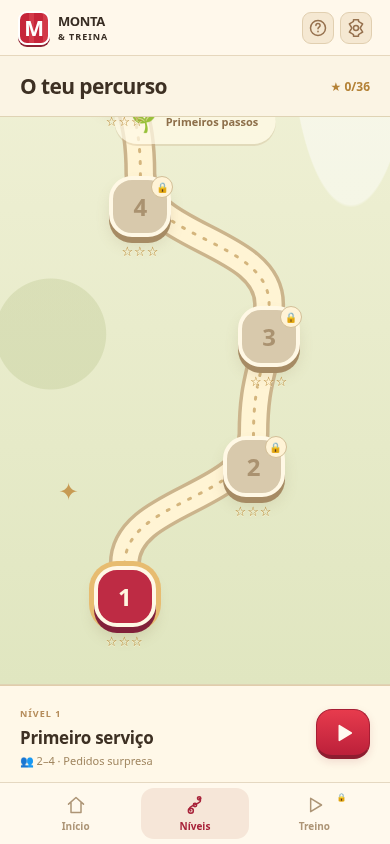
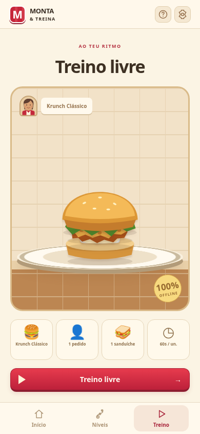
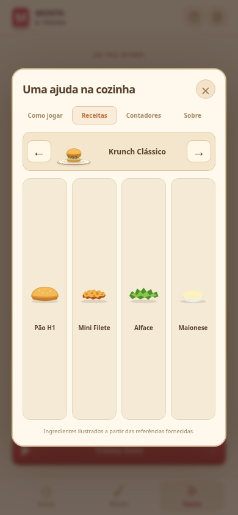

# Monta & Treina

Simulador de treino para Android, em português de Portugal. Cozinha visual com cliente, talão de pedido, ingredientes na bancada e um sanduíche que ganha camadas a cada toque. Quatro receitas base com versões Double, batatas de três tamanhos, 12 níveis com pedidos e clientes aleatórios, treino livre, revisão de erros e recordes locais. Funciona offline no APK; não usa conta, servidor, análise de utilização ou serviços externos.

## Como jogar

1. Usa a barra inferior: **Início** mostra o próximo desafio, **Níveis** abre o mapa e **Treino** abre o treino livre quando desbloqueado.
2. O mapa tem um caminho sinuoso com 12 fases, três cenários e scroll vertical próprio. Podes consultar fases bloqueadas; o botão de jogar só fica disponível após concluir a anterior. Ao abrir o mapa, o nível atual fica visível.
3. Cada tentativa sorteia o número de clientes uma vez: 2–4 nos níveis 1–4, 3–6 nos níveis 5–8 e 4–8 nos níveis 9–12. Esse total mantém-se durante a tentativa. A receita e as quantidades são sorteadas por cliente, com batatas a partir do nível 5 e versões Double a partir do 9. Repetir uma fase faz novos sorteios.
4. O **Treino livre** desbloqueia ao concluir o nível 1. As receitas Krunch Clássico, Krunch BBQ, Clássica e O’Cheddar desbloqueiam após os níveis 1, 2, 3 e 4, respetivamente. Batatas desbloqueiam após o nível 5 e Double após o 9. O treino só sorteia receitas já desbloqueadas. A ajuda permite consultar a receita do pedido atual durante uma fase, mesmo antes de a desbloquear para treino.
5. No treino livre, configura receita, modo, pedido, batatas e tempo nos cartões ilustrados. Os painéis fecham no **X** superior; as alterações são aplicadas ao escolher.
6. Toca nos ingredientes para montar e novamente para retirar. No Double, dois toques adicionam dois filetes; um terceiro limpa essas unidades. Usa **↶** para desfazer o último ingrediente. Se houver queijo, coloca-o entre os dois filetes.
7. Nas batatas, escolhe a porção indicada no talão: pequena preta, média vermelha ou grande cinzenta. Nos pedidos com vários produtos, toca em **Adicionar à bandeja** para validar cada unidade. Serve o pedido completo antes do prazo e avança para o próximo cliente.
8. Todos os clientes têm de ficar corretos para concluir uma fase. Estrelas, receitas desbloqueadas, contadores e preferências ficam no dispositivo e são preservados ao atualizar.

O nível ganha uma estrela ao servir todos os clientes; ganha duas se todos forem servidos até 80% do tempo e três se todos forem servidos até metade do tempo. Repetir um nível preserva a melhor classificação. Falhas ou desistências não desbloqueiam o seguinte.



Apenas o mapa de níveis tem scroll. Início, treino, receitas, definições, cozinha e resultados ajustam-se à altura disponível, com abas e páginas quando necessário. Os testes verificam os controlos em ecrãs de 320 × 568, 390 × 844, 740 × 360 e 1024 × 768 e confirmam que o mapa permite alcançar as fases sem deslocar o resto da aplicação.





## Pedidos combinados e contadores

Em **Treino livre → Pedido**, escolhe de 1 a 4 unidades por cliente e a composição:

- **Iguais:** repete a receita escolhida; com receita aleatória, o tipo é sorteado e repetido.
- **Variados:** disponível após desbloquear duas receitas; inclui pelo menos dois tipos. A receita escolhida participa no pedido e os restantes produtos são sorteados. Pode haver tipos repetidos e diferentes no mesmo talão.

O talão apresenta **preparados/quantidade pedida** por produto e o total do pedido. Podes tocar num produto ainda em falta para o preparar; ao mudar, a montagem atual é limpa. Depois de cada unidade válida, a bancada fica pronta para o próximo sanduíche em falta. As quotas impedem acrescentar produtos a mais. Um pedido de três sanduíches só fica concluído quando os três estiverem na bandeja e o cliente for servido.

O tempo escolhido é **por sanduíche**: 3 × 60 segundos dá 180 segundos para o cliente inteiro. Cada porção de batatas acrescenta 40% desse tempo, com mínimo de 10 segundos. Um menu de uma sandes e uma porção, com 60s por sandes, tem 84s. As batatas individuais usam o mesmo tempo por porção. O relógio continua entre montagens. A ajuda pausa o tempo como antes. Se o prazo terminar, a revisão mantém a contagem parcial de cada produto.

Em **Ajuda → Contadores**, podes consultar os totais guardados no dispositivo. **Sanduíches preparados** conta montagens validadas; **Pedidos concluídos** conta clientes servidos corretamente dentro do prazo. **Porções de batatas** conta as porções validadas, separadamente das sandes. Contadores antigos são preservados ao atualizar. Sanduíches de pedidos que ficaram incompletos continuam no contador de produção. O resumo do turno distingue pedidos e sanduíches. Um novo turno reinicia apenas os valores do turno. Os recordes de combos usam chaves separadas das receitas individuais.


## Abertura e carregamento

A abertura mostra o sanduíche a montar-se, ingredientes flutuantes e a identidade visual do jogo. Avança automaticamente ou através de **Entrar na cozinha**. O arranque nativo Android e o primeiro conteúdo HTML usam a mesma paleta.

Antes de cada pedido, uma transição animada prepara a bancada e aguarda a preparação das fontes locais. O cronómetro só começa quando a cozinha está disponível. A animação pode ser cancelada e respeita as definições de movimento reduzido. Não simula percentagens de downloads.


## Ajuda, áudio e animações

- **Ajuda:** disponível no botão de interrogação no topo. Tem abas **Como jogar**, **Receitas**, **Contadores** e **Sobre**. O guia avança passo a passo e as receitas usam ingredientes ilustrados. O relógio fica em pausa enquanto o painel está aberto e retoma ao fechá-lo.
- **Definições:** abas **Áudio** e **Movimento**, com som geral, efeitos, música de fundo tranquila (melodia original a 72 BPM), volume e animações guardados no dispositivo. Por defeito, os efeitos estão ativos, o volume fica a 60% e a música está desligada. A preferência de movimento reduzido do sistema é respeitada.
- **Sons offline:** efeitos originais sintetizados no dispositivo para pão, frango, vegetais, queijo, bacon, molhos e batatas; entrada do pedido, entrega, sucesso, erro e aviso nos últimos cinco segundos. Não há ficheiros de áudio remotos. “Testar som” permite verificar o volume.
- **Animações:** ingredientes voam entre os recipientes e a bandeja, assentam no sanduíche e a bandeja sai ao servir. As ações ficam bloqueadas durante a entrega para evitar duplicação. Os resultados apresentam estrelas e celebram um pedido perfeito com confettis.
- **Segundo plano:** a música e os efeitos param quando a aplicação deixa de estar visível. O cronómetro continua; a pausa é exclusiva do painel de ajuda e definições. O áudio é iniciado após um toque do utilizador.


## Instalar no telemóvel

[Descarregar o APK de teste para Android](https://github.com/Adjelson/KFC/raw/refs/heads/main/downloads/monta-treino-debug.apk) · Android 7.0 ou superior · versão 1.6 · 4,2 MB.

Abre o ficheiro no Android e permite a instalação desta origem, se solicitado. A assinatura do APK foi verificada; ainda não foi feita validação num telemóvel real.

## Desenvolvimento

Node.js 24 e npm 11:

```sh
npm ci
npm run dev
npm test
npm run test:e2e
npm run build
```

Os testes da interface usam Chromium em `/usr/bin/chromium`. Ajustar `playwright.config.js` para o Chromium disponível noutra máquina. O modo de desenvolvimento web requer o servidor Vite; a distribuição Android inclui todos os ficheiros.

## APK Android

Java 21, Python 3, Android SDK plataforma 36 e build-tools 36.0.0. Neste ambiente o SDK encontra-se em `/workspace/android-sdk`. Para outra máquina, definir `ANDROID_HOME`.

```sh
npm run android:apk
```

Este comando compila os recursos web, sincroniza o projeto Capacitor, executa Gradle e verifica a assinatura do APK. Resultado: `artifacts/monta-treino-debug.apk`. A compilação respeita o proxy HTTPS da máquina e mantém a verificação TLS. Dependências, SDK e distribuição Gradle precisam de internet na primeira compilação; o APK não precisa.

O APK é uma versão de teste assinada com chave de desenvolvimento, para instalação direta em Android 7.0 ou superior (SDK mínimo 24). Não é uma publicação na Play Store. Permitir instalação desta origem quando o Android o solicitar. Atualizações do mesmo APK precisam da mesma chave de assinatura; a chave de desenvolvimento não deve ser usada para distribuição pública.

## Receitas e limites do treino

Ingredientes baseados nas referências e correções fornecidas pelo utilizador:

- Krunch Clássico: pão H1, 1 Mini Filete, alface, maionese.
- Krunch BBQ: pão H1, 1 Mini Filete, queijo, molho BBQ.
- O’Cheddar: pão brioche, 1 Filete, queijo, bacon, molho cheddar, maionese.
- Clássica: pão Core, 1 Filete, tomate, alface, maionese.

O jogo avalia os ingredientes e as quantidades de filetes. Nas versões Double, usa duas unidades da proteína da receita (Filete ou Mini Filete), com queijo entre elas quando incluído, conforme a indicação do utilizador. A disposição dos restantes ingredientes é ilustrativa; gramagens e número de fatias de bacon não são avaliados. As porções de batatas são regras do simulador, sem gramagens oficiais. As receitas da ajuda usam um seletor ilustrado com setas, sem listas nativas do sistema. Os limites de tempo são regras do jogo, não padrões oficiais de preparação. Os ícones são ilustrativos. Aplicação independente, sem afiliação à KFC.

A contagem continua se a aplicação ficar em segundo plano; a ronda termina ao voltar se o prazo tiver passado. A ajuda e as definições pausam o relógio enquanto estão abertas. Só rondas concluídas corretamente antes do prazo contam para o recorde. Os recordes são locais e podem desaparecer ao limpar os dados ou desinstalar a aplicação.
