# Monta & Treina

Simulador de treino para Android, em português de Portugal. Cozinha visual com fila de clientes, relógios e reações individuais, talões e alimentos servidos em pratos, taças e bandejas. Uma instalação nova começa com pão H1 simples: as moedas compram ingredientes para chegar às quatro receitas completas, versões Double, batatas e bebidas. Inclui 12 níveis com pedidos e clientes aleatórios, treino livre, melhorias do restaurante, medalhas, revisão de erros e corrida aos recordes locais. Funciona offline no APK; não usa conta, servidor, análise de utilização ou serviços externos.

## Como jogar

1. A aplicação abre diretamente em **Níveis**. A barra inferior tem apenas **Níveis** e **Treino**, que abre o treino livre quando desbloqueado.
2. O mapa tem um caminho sinuoso com 12 fases, três cenários ilustrados e scroll vertical próprio: exterior do restaurante com esplanada e entregas, sala de refeições com balcões e menus, e cozinha com fogões e utensílios. As ilustrações são locais e o vapor respeita as definições de animação. Podes consultar fases bloqueadas; o botão de jogar só fica disponível após concluir a anterior. Ao abrir o mapa, o nível atual fica visível.
3. Cada tentativa sorteia o número de clientes uma vez: 2–4 nos níveis 1–4, 3–6 nos níveis 5–8 e 4–8 nos níveis 9–12. Esse total mantém-se durante a tentativa. A receita e as quantidades são sorteadas por cliente, usando os ingredientes já comprados: bebidas a partir do nível 3, batatas a partir do 5 e versões Double a partir do 9. Repetir uma fase faz novos sorteios. As primeiras compras acrescentam pão com Mini Filete e pão com frango e maionese; quando há receitas completas disponíveis, as fases passam a usá-las.
4. O **Treino livre** desbloqueia ao concluir o nível 1, com as receitas simples disponíveis. As receitas Krunch Clássico, Krunch BBQ, Clássica e O’Cheddar ficam disponíveis após os níveis 1, 2, 3 e 4, respetivamente, desde que os seus ingredientes tenham sido comprados. Batatas requerem o nível 5 e a estação de batatas; Double requer o nível 9. As receitas simples não têm versão Double. O treino só sorteia receitas já desbloqueadas. A ajuda permite consultar todas as receitas.
5. No treino livre, configura receita, modo, pedido, batatas e tempo nos cartões ilustrados. Os painéis fecham no **X** superior; as alterações são aplicadas ao escolher.
6. Toca nos ingredientes para montar e novamente para retirar. No Double, dois toques adicionam dois filetes; um terceiro limpa essas unidades. Usa **↶** para desfazer o último ingrediente. Se houver queijo, coloca-o entre os dois filetes.
7. Nas batatas, escolhe a porção indicada no talão: pequena preta, média vermelha ou grande cinzenta. Nos níveis e nos pedidos combinados, **a montagem correta passa automaticamente para a bandeja**. Para entregar, **desliza o prato ou a bandeja até ao cliente ou ao seu talão**. Podes entregar parte de um pedido nos níveis para libertar espaço. No treino livre, serve o pedido completo antes do prazo. Com teclado, seleciona o prato e carrega em Enter ou Espaço.
8. Todos os clientes têm de ficar corretos para concluir uma fase. Depois do último cliente, uma janela mostra **vitória ou derrota, estrelas, clientes servidos e moedas ganhas**, com animação e som próprios. A janela aguarda o jogador; as moedas já foram creditadas durante o serviço e não se repetem ao fechar. Ao tocar em **Ver níveis** ou no **X**, o mapa seleciona a fase seguinte e apresenta a animação de desbloqueio e o selo NOVO. Se a fase falhar, permite repetir; no nível 12, mostra o percurso concluído. Estrelas, receitas desbloqueadas, contadores e preferências ficam no dispositivo e são preservados ao atualizar.

O nível ganha uma estrela ao servir todos os clientes; ganha duas se todos forem servidos até 80% do tempo e três se todos forem servidos até metade do tempo. Repetir um nível preserva a melhor classificação. Falhas ou desistências não desbloqueiam o seguinte.


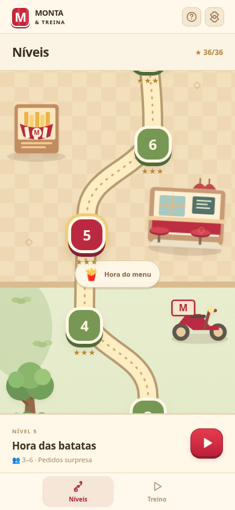

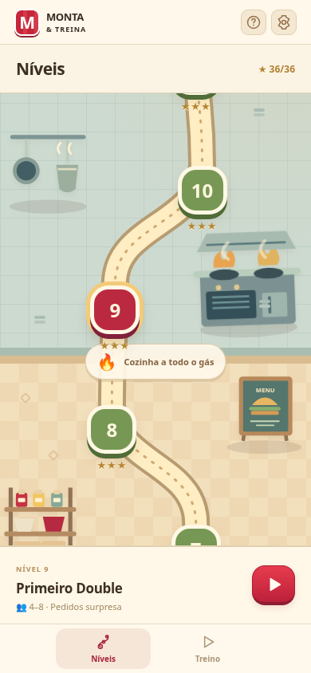

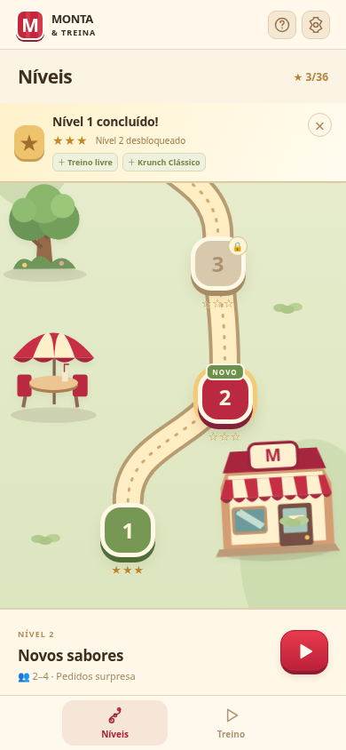

Apenas o mapa de níveis tem scroll. Treino, receitas, definições, cozinha e resultados ajustam-se à altura disponível, com abas e páginas quando necessário. Os testes verificam os controlos em ecrãs de 320 × 568, 390 × 844, 740 × 360 e 1024 × 768 e confirmam que o mapa permite alcançar as fases sem deslocar o resto da aplicação.


## Restaurante, clientes e recordes

Nos níveis, a cozinha atende até **três clientes em simultâneo**. Toca num retrato para mudar de talão: os ingredientes deixados a meio e os produtos preparados ficam associados a esse cliente. **Todos os clientes presentes mostram o seu próprio relógio e barra de paciência**, incluindo os que não estão selecionados. As caras mudam de contente para impaciente com 60% do tempo restante, e para zangado com 25%. Dois clientes chegam no início; o terceiro pode chegar após oito segundos. A fila volta a preencher-se quando alguém sai.

- **Habitual:** mais paciência.
- **Com pressa:** menos tempo, pedidos menores e gorjetas maiores.
- **Família:** pedidos que podem ter mais unidades e mais tempo para os preparar.
- **Gourmet:** paciência normal e prémio de atendimento maior.

A bandeja começa com **dois espaços partilhados** entre os clientes. A montagem é validada a cada ingrediente e, quando fica correta, passa sozinha para a bandeja. O prato central permite arrastar os produtos prontos até ao respetivo cliente ou talão, libertando os espaços. Uma entrega ao cliente errado ou um gesto cancelado conserva os produtos. Não há botões de preparar ou entregar por baixo da mesa; o indicador de capacidade fica no topo. O talão soma o que já foi entregue ao que está pronto, e só fecha quando todas as quantidades estiverem completas. Ingredientes errados, filetes em falta e bandejas cheias não aumentam os contadores. Se a paciência acabar, o cliente sai e a fase fica por concluir; podes servir os restantes para continuar a ganhar moedas.

Cada entrega parcial recupera **3 segundos por produto novo, até 6 segundos por entrega**, apenas para esse cliente, com indicação animada e uma reação contente. O limite acumulado é 20% do prazo inicial, arredondado ao segundo, com mínimo de 3 e máximo de 15 segundos por cliente. Repetir a ação sem novos produtos não dá tempo; pedidos completos ou expirados também não recebem o bónus.

**Coca-Cola, Pepsi e Sumol** podem acompanhar as sandes ou constituir pedidos só de bebidas. Seleciona a bebida no talão e toca na lata correta para a acrescentar à bandeja; trocar de marca não valida o produto. As três marcas têm cores e desenhos próprios. O pão Core, o H1 e o brioche também têm formas diferentes, e o Filete distingue-se do Mini Filete. Os pães ficam em cestos, os alimentos e bebidas em bandejas e os molhos dentro de tigelas com colher. Cada recipiente é desenhado com o seu conteúdo, evitando um prato genérico atrás de todos os alimentos.

Um cliente completo dá moedas: uma base, valor por produto, gorjeta conforme a rapidez e o tipo de cliente, e bónus de sequência até cinco clientes. A entrega parcial não dá moedas. O treino livre também dá moedas ao concluir um pedido correto. O prémio fica guardado logo ao servir; uma fase falhada não retira os prémios dos clientes que foram servidos.

A **carteira no topo**, tanto no mapa como durante a partida, abre o restaurante com quatro abas e sem scroll. Durante a partida, a loja pausa todos os clientes:

- **Ingredientes:** três compras ilustradas por página. Mini Filete custa 15 moedas, alface e maionese 10 cada; os restantes ingredientes têm o preço indicado. A estação de batatas custa 25 e cada marca de bebida custa 20. As compras são permanentes e só se pagam uma vez. Novos ingredientes e receitas entram nos serviços seguintes; os pedidos de uma partida já iniciada mantêm-se. Os novos jogos começam apenas com pão H1; a atualização preserva os ingredientes que já estavam disponíveis nas instalações anteriores. As bebidas novas precisam de ser compradas.
- **Melhorias:** bandeja de 4 e depois 6 espaços (40/100 moedas); bancada com mais 8% e depois 16% de tempo por cliente (50/120 moedas). As melhorias aplicam-se às novas tentativas dos níveis. Uma corrida ao recorde mantém os tempos guardados no plano original.
- **Decoração:** esplanada florida (30 moedas + 3 estrelas), sala renovada (70 + 6) e cozinha do chef (120 + 10). As compras acrescentam elementos visíveis ao mapa; a cozinha do chef também muda os acabamentos da bancada. As estrelas gastas são descontadas do saldo da loja, preservando a classificação de cada nível. Repetir uma fase não repõe estrelas já gastas.
- **Álbum:** cada produto ganha medalhas **Aprendiz**, **Especialista** e **Mestre** após 1, 10 e 30 unidades corretas. Inclui as receitas iniciais, sandes completas, Double, batatas e bebidas. Conta a produção validada, mesmo se o cliente não chegar a receber o pedido completo. O álbum tem páginas e uma celebração aparece ao ganhar uma medalha.

Ao concluir uma fase, é guardado o melhor tempo com **os pedidos exatos, as personalidades, os prazos e os instantes das entregas**. O botão com o fantasma no cartão desse nível inicia uma corrida aos mesmos pedidos. A barra compara clientes servidos por ti e pelo recorde ao longo do tempo. Uma tentativa mais lenta ou falhada não substitui o recorde. A ajuda, as definições e a loja pausam todos os clientes e a comparação.

Na horizontal, a partida ocupa toda a largura e altura disponíveis. A sala, os clientes e a bancada formam uma cena contínua em perspetiva. Os ingredientes ficam em recipientes dos dois lados; o sanduíche é montado no centro. Os talões surgem junto de cada cliente, com miniaturas dos produtos e quantidades; o talão selecionado permite escolher e paginar produtos. Ajuda, definições e saída ficam em botões compactos sobre o cenário, sem uma faixa de cabeçalho separada. O treino livre usa a mesma bancada.

O cenário e os quatro personagens, incluindo as expressões de impaciência e irritação, são arte gerada para a aplicação, otimizada para WebP e incluída no APK. A primeira partida aguarda o carregamento e a descodificação das três imagens antes de iniciar o relógio. Os clientes têm animação de entrada e movimento subtil em espera; as preferências de animação continuam a ser respeitadas.

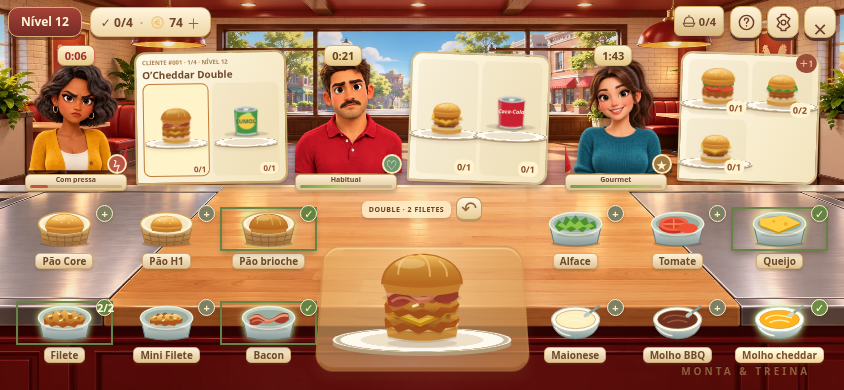

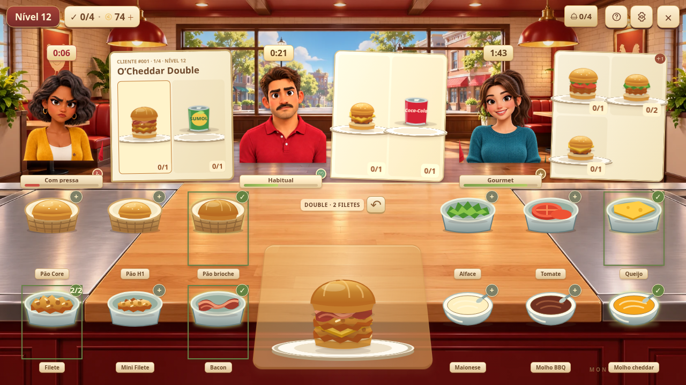

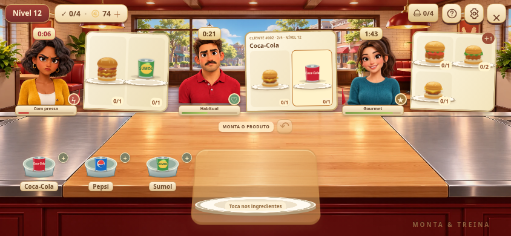

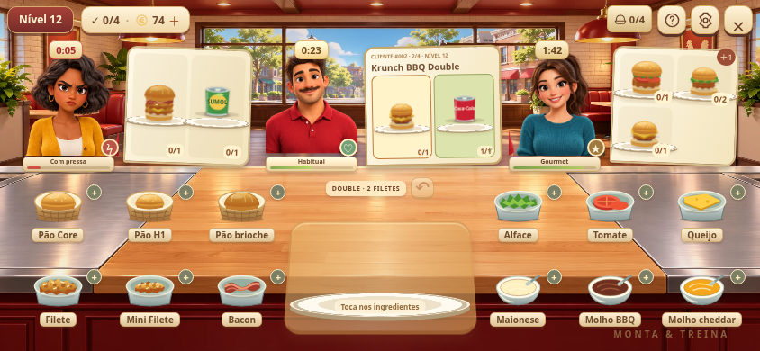

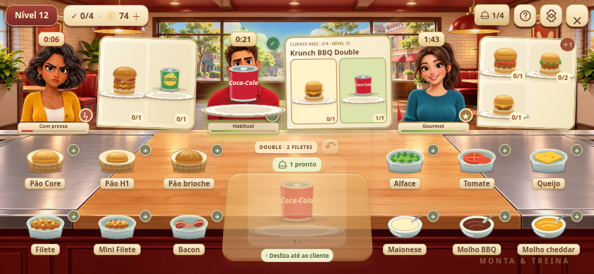

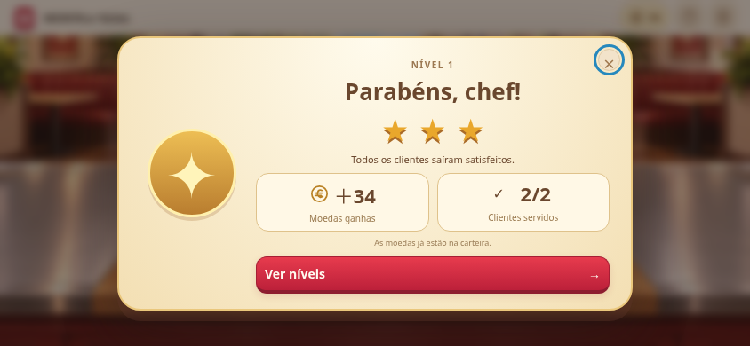

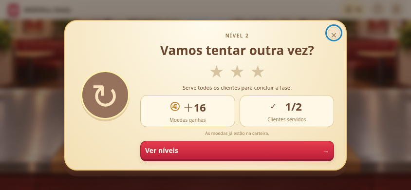

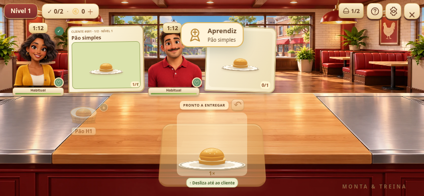

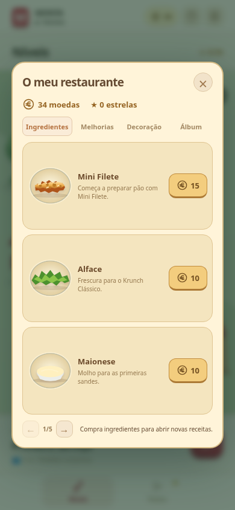

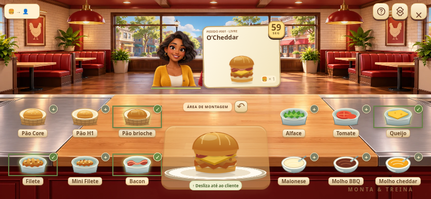

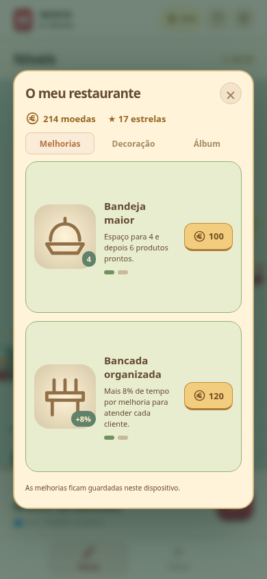

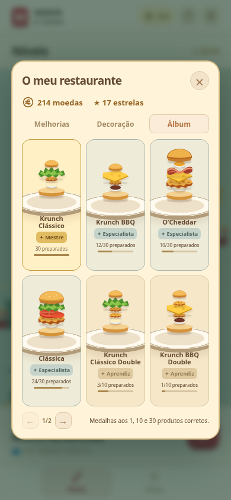

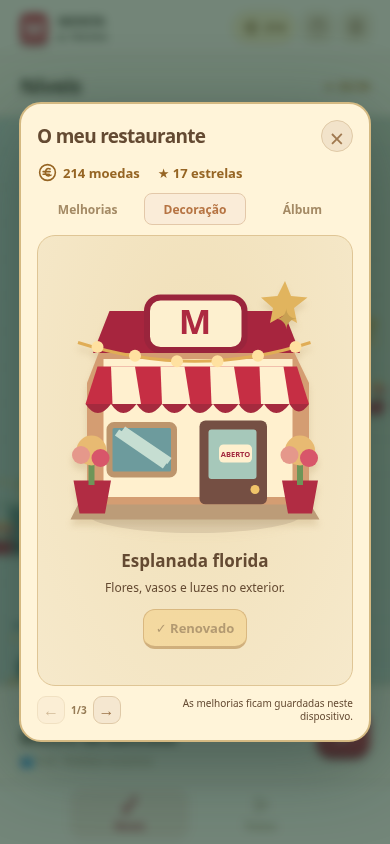

No **APK**, a cozinha e o carregamento passam para a horizontal por defeito. O mapa e a configuração do treino livre respeitam a orientação do dispositivo. Em **Definições → Movimento → Cozinha horizontal**, podes desativar essa preferência. A interface web adapta-se ao formato da janela. Durante a partida e o carregamento, o Android oculta as barras de estado e navegação; um gesto na margem permite mostrá-las temporariamente. As barras regressam ao sair da cozinha. A rotação e o modo de ecrã inteiro foram compilados no APK e requerem confirmação num dispositivo Android real.

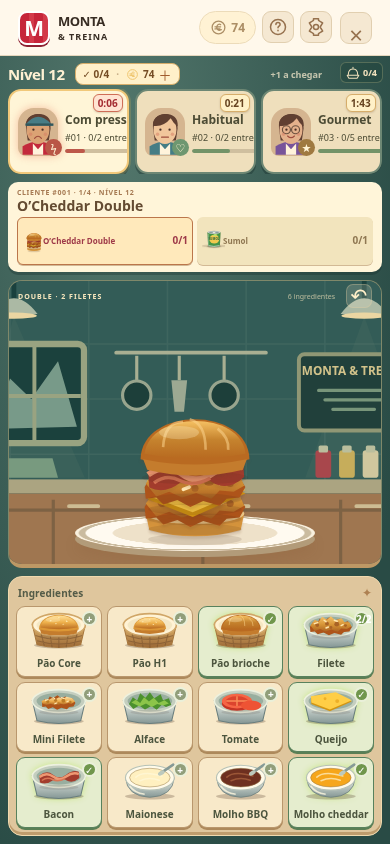

A entrada dos clientes, o voo e assentamento dos ingredientes, a passagem à bandeja, as entregas com prémio e as medalhas têm animações próprias. A opção de animações e a preferência do sistema para reduzir movimento abrangem os novos efeitos.

## Pedidos combinados e contadores

Em **Treino livre → Pedido**, escolhe de 1 a 4 unidades por cliente e a composição:

- **Iguais:** repete a receita escolhida; com receita aleatória, o tipo é sorteado e repetido.
- **Variados:** disponível após desbloquear duas receitas; inclui pelo menos dois tipos. A receita escolhida participa no pedido e os restantes produtos são sorteados. Pode haver tipos repetidos e diferentes no mesmo talão.

O talão apresenta **preparados/quantidade pedida** por produto e o total do pedido. Podes tocar num produto ainda em falta para o preparar; ao mudar, a montagem atual é limpa. Depois de cada unidade válida, a bancada fica pronta para o próximo sanduíche em falta. As quotas impedem acrescentar produtos a mais. Um pedido de três sanduíches só fica concluído quando os três estiverem na bandeja e o cliente for servido.

O tempo escolhido é **por sanduíche**: 3 × 60 segundos dá 180 segundos para o cliente inteiro. Cada porção de batatas acrescenta 40% desse tempo, com mínimo de 10 segundos. Um menu de uma sandes e uma porção, com 60s por sandes, tem 84s. As batatas individuais usam o mesmo tempo por porção. O relógio continua entre montagens. A ajuda pausa o tempo como antes. Se o prazo terminar, a revisão mantém a contagem parcial de cada produto.

Em **Ajuda → Contadores**, podes consultar os totais guardados no dispositivo. **Sanduíches preparados** conta montagens validadas; **Pedidos concluídos** conta clientes servidos corretamente dentro do prazo. **Porções de batatas** e **Bebidas preparadas** têm contagens separadas das sandes. Contadores antigos são preservados ao atualizar. Sanduíches de pedidos que ficaram incompletos continuam no contador de produção. O resumo do turno distingue pedidos e sanduíches. Um novo turno reinicia apenas os valores do turno. Os recordes de combos usam chaves separadas das receitas individuais.


## Abertura e carregamento

A abertura mostra o sanduíche a montar-se, ingredientes flutuantes e a identidade visual do jogo. Avança automaticamente ou através de **Entrar na cozinha**. O arranque nativo Android e o primeiro conteúdo HTML usam a mesma paleta.

Antes de cada fase ou ronda de treino, uma transição animada prepara a bancada e aguarda a preparação das fontes locais. O cronómetro só começa quando a cozinha está disponível. A animação pode ser cancelada e respeita as definições de movimento reduzido. Não simula percentagens de downloads.


## Ajuda, áudio e animações

- **Ajuda:** disponível no botão de interrogação no topo. Tem abas **Como jogar**, **Receitas**, **Contadores** e **Sobre**. O guia avança passo a passo e as receitas usam ingredientes ilustrados. O relógio fica em pausa enquanto o painel está aberto e retoma ao fechá-lo.
- **Definições:** abas **Áudio** e **Movimento**, com som geral, efeitos, música de fundo tranquila (melodia original a 72 BPM), volume, animações e preferência de cozinha horizontal guardados no dispositivo. Por defeito, os efeitos estão ativos, o volume fica a 60% e a música está desligada. A preferência de movimento reduzido do sistema é respeitada.
- **Sons offline:** efeitos originais sintetizados no dispositivo para pão, frango, vegetais, queijo, bacon, molhos, batatas e bebidas. Há sons distintos para entrar na partida, concluir uma montagem, entregar um pedido, ganhar ou perder uma fase, e reações de satisfação, impaciência e irritação. As reações de espera soam apenas quando a expressão muda, com intervalo entre avisos. Efeitos, volume, som geral e segundo plano controlam também estes sons. Não há ficheiros de áudio remotos. “Testar som” permite verificar o volume.
- **Animações:** ingredientes voam entre os recipientes e a bandeja, assentam no sanduíche e a bandeja sai ao servir. As ações ficam bloqueadas durante a entrega para evitar duplicação. Os resultados apresentam estrelas e celebram um pedido perfeito com confettis.
- **Segundo plano:** a música e os efeitos param quando a aplicação deixa de estar visível. O cronómetro continua; ajuda, definições e loja pausam os relógios enquanto estão abertas. O áudio é iniciado após um toque do utilizador.


## Instalar no telemóvel

[Descarregar o APK de teste para Android](https://github.com/Adjelson/KFC/raw/refs/heads/main/downloads/monta-treino-debug.apk) · Android 7.0 ou superior · versão 1.11 · cerca de 5,2 MB.

Abre o ficheiro no Android e permite a instalação desta origem, se solicitado. A assinatura do APK foi verificada; ainda não foi feita validação num telemóvel real.

## Desenvolvimento

Node.js 24 e npm 11:

```sh
npm ci
npm run dev
npm test
npm run test:e2e
npm run build
```

Os testes da interface usam Chromium em `/usr/bin/chromium`. Ajustar `playwright.config.js` para o Chromium disponível noutra máquina. O modo de desenvolvimento web requer o servidor Vite; a distribuição Android inclui todos os ficheiros.

## APK Android

Java 21, Python 3, Android SDK plataforma 36 e build-tools 36.0.0. Neste ambiente o SDK encontra-se em `/workspace/android-sdk`. Para outra máquina, definir `ANDROID_HOME`.

```sh
npm run android:apk
```

Este comando compila os recursos web, sincroniza o projeto Capacitor, executa Gradle e verifica a assinatura do APK. Resultado: `artifacts/monta-treino-debug.apk`. A compilação respeita o proxy HTTPS da máquina e mantém a verificação TLS. Dependências, SDK e distribuição Gradle precisam de internet na primeira compilação; o APK não precisa.

O APK é uma versão de teste assinada com chave de desenvolvimento, para instalação direta em Android 7.0 ou superior (SDK mínimo 24). Não é uma publicação na Play Store. Permitir instalação desta origem quando o Android o solicitar. Atualizações do mesmo APK precisam da mesma chave de assinatura; a chave de desenvolvimento não deve ser usada para distribuição pública.

## Receitas e limites do treino

Ingredientes baseados nas referências e correções fornecidas pelo utilizador:

- Krunch Clássico: pão H1, 1 Mini Filete, alface, maionese.
- Krunch BBQ: pão H1, 1 Mini Filete, queijo, molho BBQ.
- O’Cheddar: pão brioche, 1 Filete, queijo, bacon, molho cheddar, maionese.
- Clássica: pão Core, 1 Filete, tomate, alface, maionese.

Para iniciar a progressão, existem também pão H1 simples, pão H1 com Mini Filete e pão H1 com Mini Filete e maionese. São exercícios introdutórios do simulador. As bebidas são representações ilustradas de latas de Coca-Cola, Pepsi e Sumol; não há preparação de bebidas com dispensador.

O jogo avalia os ingredientes e as quantidades de filetes. Nas versões Double, usa duas unidades da proteína da receita (Filete ou Mini Filete), com queijo entre elas quando incluído, conforme a indicação do utilizador. A disposição dos restantes ingredientes é ilustrativa; gramagens e número de fatias de bacon não são avaliados. As porções de batatas são regras do simulador, sem gramagens oficiais. As receitas da ajuda usam um seletor ilustrado com setas, sem listas nativas do sistema. Os limites de tempo são regras do jogo, não padrões oficiais de preparação. Os ícones são ilustrativos. Aplicação independente, sem afiliação à KFC.

A contagem continua se a aplicação ficar em segundo plano; a ronda termina ao voltar se o prazo tiver passado. A ajuda, as definições e a loja pausam os relógios enquanto estão abertas. Só rondas concluídas corretamente antes do prazo contam para o recorde. Os recordes são locais e podem desaparecer ao limpar os dados ou desinstalar a aplicação.
